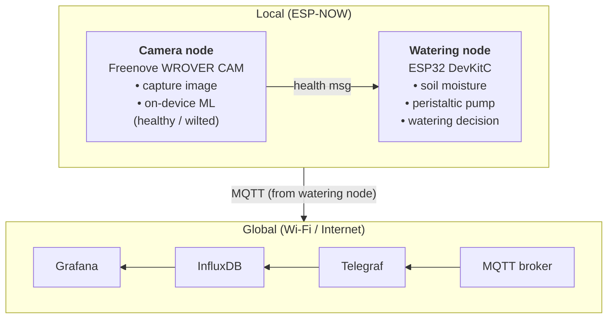

# Smart Irrigation with Edge-ML Wilt Detection

An IoT system that waters a potted basil plant based on **soil moisture** and **what the plant looks like**. A camera node runs a small image classifier on-device to detect wilting. A watering node combines that with soil moisture to decide when to run a peristaltic pump. All data flows to the cloud for storage and dashboarding.

**Domain:** 0 – Smart Agriculture & Food Systems
**Due:** 23:59 Sunday, 1 November 2026

---

## Problem

Simple soil-moisture irrigation only measures the soil at one point. The plant's actual condition (water stress, wilting) isn't observed. By adding on-device vision, the system confirms water stress from the plant itself. It also tracks exactly how much water is delivered, so usage can be compared against a fixed-timer schedule.

## Architecture



- **Local communication:** the camera node sends its health result (`healthy`/`wilted` + confidence) to the watering node over **ESP-NOW**. That result feeds directly into the watering decision.
- **Global communication:** the watering node publishes telemetry and pump events over **MQTT**. **Telegraf** subscribes and writes them to **InfluxDB**, and **Grafana** presents them.

## Responsibility declaration

| Student | Primary technical responsibility | Shared responsibility |
|---|---|---|
| **Caleb Venner** | Watering node: moisture sensing and calibration, pump driver, watering control logic. ESP-NOW link between nodes (sender on camera node, receiver on watering node). MQTT publishing from the watering node. Hardware assembly. | Integration, testing |
| **Aida** | Edge ML: training data collection and labelling, model training (Edge Impulse), on-device inference code for the camera node. Cloud chain: MQTT broker setup, topic and payload design, Telegraf → InfluxDB, Grafana dashboard. | Integration, testing |

### Rubric mapping (TaskG1)

| Aspect | Owner | Where |
|---|---|---|
| Sensing, actuation and embedded control | Caleb | `src/watering/` |
| Local communication (ESP-NOW) | Caleb | `include/plant_msgs.h`, `src/camera/espnow_tx.*`, `src/watering/espnow_rx.*` |
| Global communication and cloud data chain | Aida (MQTT publish code: Caleb) | `cloud/`, `src/watering/mqtt_pub.*` |
| Data presentation (Grafana) | Aida | `cloud/grafana/` |
| Advanced processing (edge ML) | Aida | `src/camera/inference.*`, `src/capture/` |

## Repository layout

One PlatformIO project at the root, with one env per firmware.

```
.
├── platformio.ini            # envs: camera, camera-mock, capture, watering, watering-mock
├── include/
│   ├── plant_msgs.h          # ESP-NOW message struct + MQTT topic names (single source of truth)
│   └── secrets.example.h     # copy to include/secrets.h (git-ignored)
├── lib/                      # Edge Impulse Arduino library export (Aida)
├── src/
│   ├── camera/               # camera node, Freenove ESP32-WROVER CAM (Aida; espnow_tx: Caleb)
│   ├── capture/              # data collection: timed photos to SD card (Aida)
│   └── watering/             # watering node, ESP32 DevKitC (Caleb)
├── cloud/
│   ├── telegraf/telegraf.conf
│   └── grafana/              # exported dashboard JSON
└── docs/
```

### Building

```sh
cp include/secrets.example.h include/secrets.h   # then fill in
pio run -e camera -t upload                      # or: camera-mock, capture, watering, watering-mock
pio device monitor
```

In VS Code, pick the env from the PlatformIO toolbar.

## Interfaces

These are the contract between the two of us. Change them only by agreement, and edit them in `include/plant_msgs.h`.

### ESP-NOW: camera node → watering node

```c
typedef struct __attribute__((packed)) {
  uint8_t  version;       // message format version (1)
  uint8_t  state;         // 0 = healthy, 1 = wilted, 2 = unknown
  float    confidence;    // 0.0 – 1.0
  uint32_t seq;           // increments every send
  uint32_t inference_ms;  // time taken by on-device inference
} PlantHealthMsg;
```

- Sent once per inference, roughly every 60 s.
- Both nodes must be on the **same Wi-Fi channel** as the router used by the watering node.

### MQTT topics (proposed, Aida to confirm)

| Topic | Payload (JSON) | When |
|---|---|---|
| `farm/basil_aida_caleb/telemetry` | `{"moisture_pct":41.5,"moisture_raw":2310,"pump":0,"health_state":"healthy","health_conf":0.91,"health_age_s":12,"water_ml_total":180}` | every 10 s |
| `farm/basil_aida_caleb/events` | `{"event":"pump_run","reason":"dry+wilted","duration_ms":4000,"ml":25}` | on each watering |
| `farm/basil_aida_caleb/status` | `online` / `offline` (retained, last will) | on connect/disconnect |

## Watering logic (summary)

- **Dry:** moisture below the low threshold → water.
- **Borderline:** moisture in the middle band **and** the camera reports `wilted` with confidence ≥ 0.7 in the last 5 minutes → water.
- **Wet:** moisture above the high threshold → never water (hysteresis).
- **Safety:** maximum pump run per cycle, and a soak/cooldown period between cycles.
- **Stale camera data:** if the camera result is old or missing, fall back to moisture-only.

## Hardware

| Part | Node |
|---|---|
| Freenove ESP32-WROVER CAM (OV2640, 8 MB PSRAM) | Camera node |
| ESP32 DevKitC + expansion board | Watering node |
| Capacitive soil moisture sensor | Watering node |
| Peristaltic pump + relay / logic-level MOSFET + flyback diode, separate pump supply | Watering node |
| Supermarket basil 🌿 | Both |

## Development without meeting up

- All physical hardware lives at Caleb's place. Aida develops the ML and cloud side remotely and tests on her own camera board.
- Camera firmware is pushed to this repo and flashed onto Caleb's camera board for integration.
- Training data comes from both basil plants, which improves robustness to different plants and lighting.
- Mock modes (`MOCK_SENSORS`, `MOCK_HEALTH`) let each node run without the other.
- **Fallback:** if the ML model isn't ready by around 30 Oct, the camera node uses a colour heuristic (share of yellow/brown pixels) so the system still works end to end.

## Submission checklist

- [ ] Group video, ≤ 5 min (problem, design, working prototype, local + global paths)
- [ ] Individual video per student, ≤ 10 min (name + student ID at start, on camera throughout)
- [ ] ZIP of source code and config files
- [ ] Responsibility declaration (table above)
- [ ] Optional: prototype photos
