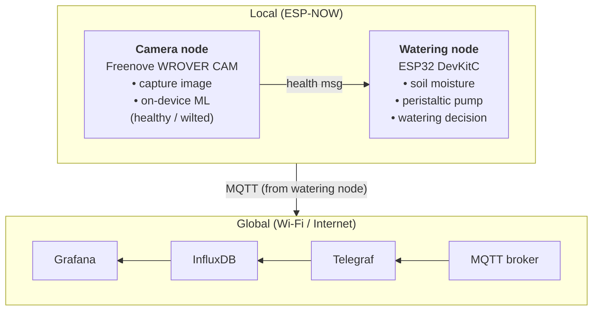

# Architecture



## Sequence

1. **Camera capture**: camera node grabs a `96x96` RGB565 frame (`camera_capture()`) every `INFERENCE_INTERVAL_MS` (60 s), on a FreeRTOS task pinned to core 1, silencing XCLK between captures.
2. **Inference**: `inference_run()` downsamples the frame to a `32x32` RGB planar float tensor and runs `TinyBasilCNN` (`src/camera/model_weights.h`) to classify the plant as `healthy` or `wilted` with confidence.
3. **ESP-NOW**: `espnow_tx_send()` sends a `PlantHealthMsg` on the router's channel (found by SSID scan).
4. **Control decision**: the watering node stores the latest message (`espnow_rx_latest()`), reads pulsed-power soil moisture, and `control_decide()` applies the dry / borderline+wilted / wet / cooldown / stale-camera rules using runtime thresholds stored in NVS (configurable via `http://basil-water.local/`).
5. **Pump**: `pump_run_ms()` / `pump_run_ml()` drives the 12V peristaltic pump via a 3-channel parallel ULN2003A non-blocking timer, capped at `max_run_ms`, and tracks delivered mL.
6. **MQTT**: telemetry every `telemetry_s` (default 10 s) to `farm/basil1/telemetry`, an event per watering to `farm/basil1/events`, and online/offline (last will) on `farm/basil1/status`.
7. **Telegraf**: subscribes to the topics and parses the JSON.
8. **InfluxDB**: stores the time series (`basil_telemetry`, `basil_events`, `basil_status`).
9. **Grafana**: renders the live dashboard.

## Related Documentation

- [Watering Node Wiring & Hardware Specification](watering_node_wiring.md)
- [ML Model Training & Deployment Guide](model_training_guide.md)
- [Cloud Infrastructure & Local Docker Stack Guide](../cloud/README.md)

## Interfaces

Single source of truth: `include/plant_msgs.h`.

### ESP-NOW: camera node → watering node

```c
typedef struct __attribute__((packed)) {
  uint8_t  version;       // message format version (1)
  uint8_t  state;         // 0 = healthy, 1 = wilted, 2 = unknown
  float    confidence;    // 0.0 – 1.0
  uint32_t seq;           // increments every send
  uint32_t inference_ms;  // time taken by on-device inference
} PlantHealthMsg;
```

Both nodes must be on the **same Wi-Fi channel** as the watering node's router.

### MQTT topics

| Topic | Payload (JSON) | When |
|---|---|---|
| `farm/basil1/telemetry` | `{"moisture_pct":41.5,"moisture_raw":2310,"pump":0,"health_state":"healthy","health_conf":0.91,"health_age_s":12,"water_ml_total":180}` | every 10 s |
| `farm/basil1/events` | `{"event":"pump_run","reason":"dry+wilted","duration_ms":4000,"ml":25}` | on each watering |
| `farm/basil1/status` | `online` / `offline` (retained, last will) | on connect/disconnect |

`health_age_s` is `-1` until the first camera message arrives.
